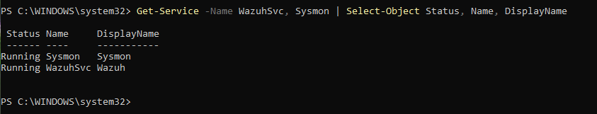
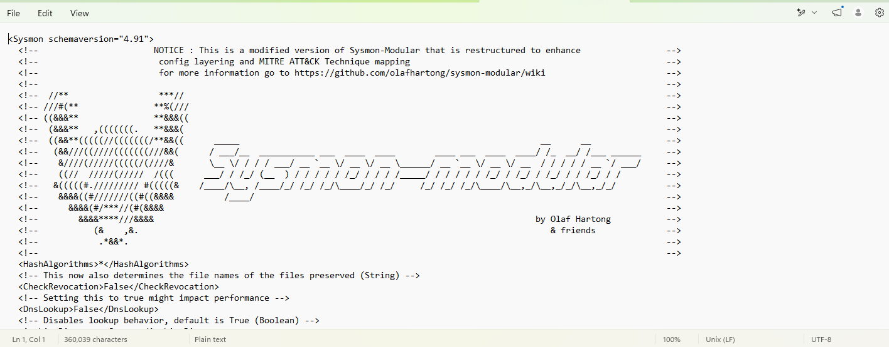
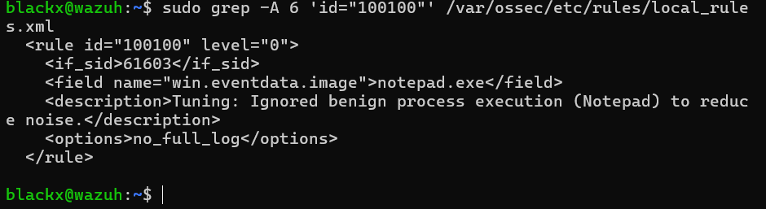
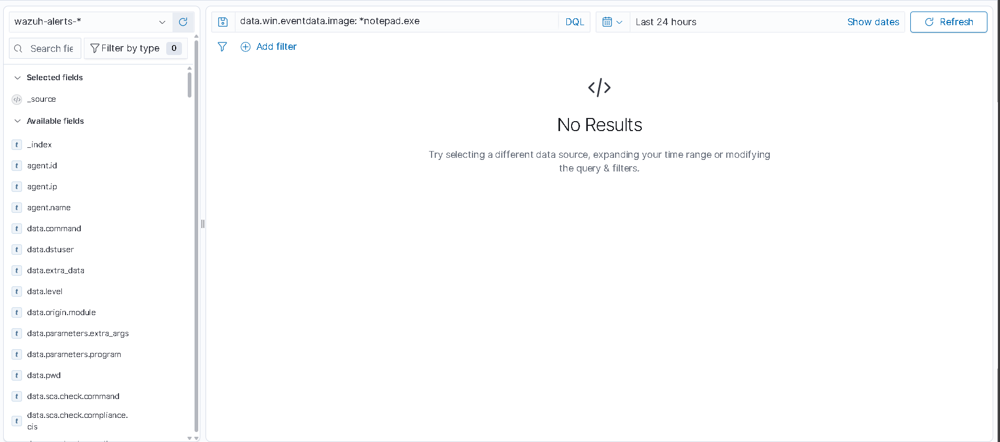
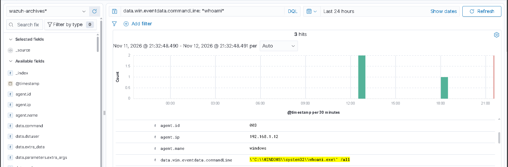

# 🛡️ Project 1: Enterprise-Grade SIEM Tuning & Endpoint Visibility

## 🎯 Objective
To engineer a production-ready Security Information and Event Management (SIEM) environment focused on high-fidelity alerting. The goal was to integrate advanced endpoint telemetry (Sysmon) with Wazuh, enable deep forensic archiving, and proactively tune the system to eliminate alert fatigue and prevent SIEM overload.

## 🏗️ Architecture
- **SIEM Manager:** Ubuntu 22.04 (Wazuh All-in-One Deployment)
- **Endpoint:** Windows 11 (Wazuh Agent + Sysmon)
- **Configuration Standard:** Olaf Hartong Sysmon Modular (Balanced Profile)

---

## ⚙️ Implementation & Evidence

### 1. Advanced Endpoint Telemetry
Deployed Sysmon using the industry-standard **Olaf Hartong** balanced configuration. This provides deep visibility into Process Creation (Event ID 1), File Creation (Event ID 11), and Network Connections, while intelligently filtering out benign background noise.

### 2. Proactive SIEM Tuning (Noise Reduction)
A common pitfall in SIEM deployments is alert fatigue. To combat this, I authored a custom tuning rule (`local_rules.xml`, Rule ID: 100100) to suppress benign, high-volume processes (e.g., `notepad.exe`) by setting their alert level to 0.

*Proof of Success: Zero alerts generated for benign Notepad execution.*

### 3. Full Log Archiving for Threat Hunting
Modified the Wazuh Manager `ossec.conf` to enable `<logall_json>yes</logall_json>` and configured Filebeat to ship raw archives to the indexer. This ensures that even non-alerting events (Level 0) are retained for proactive Threat Hunting and forensic investigations.
*Proof of Success: Raw `whoami` execution captured in archives despite being suppressed in alerts.*

---

## 💡 Key Takeaways & Business Value
- **Reduced Alert Fatigue:** Custom tuning ensures SOC analysts only investigate high-fidelity, actionable alerts.
- **Resource Optimization:** Preventing the logging of benign processes protects the SIEM from Buffer Overflow and reduces storage costs.
- **Forensic Readiness:** Full archiving guarantees that no telemetry is lost, enabling robust retrospective Threat Hunting.

## 🚀 Next Steps
This foundation paves the way for advanced use cases, including MITRE ATT&CK mapped detection rules, automated Active Response (IPS), and AI-powered log triage.
